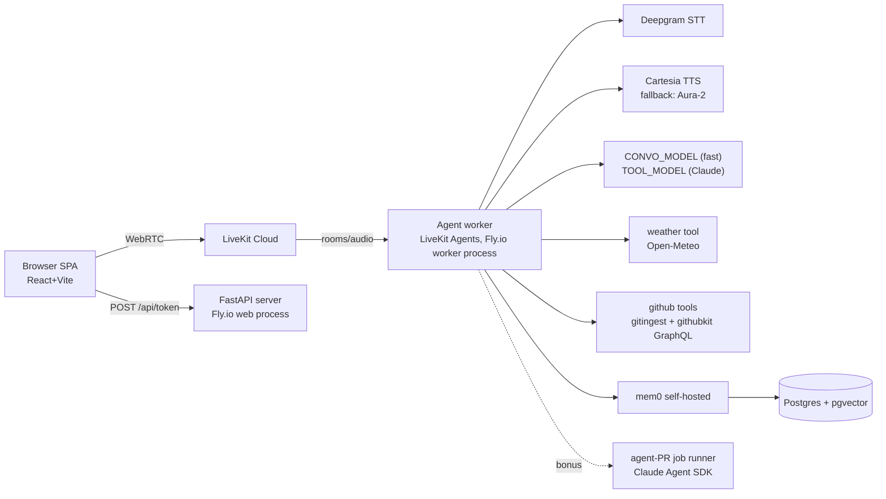

# Jarvis — Design

## Architecture



Repo layout (pinned; ticket scopes reference it):

```
backend/src/jarvis/{pipeline,server,llm,tools,memory,cadence,auth,agents_pr}/
backend/tests/{pipeline,grounding,tools,memory,cadence,multiuser,agent_pr}/
backend/evals/            # golden.jsonl + runner
frontend/src/             # SPA (auth/, wake/ arrive with bonuses)
scripts/  infra: fly.toml, backend/Dockerfile  .github/workflows/ci.yml
```

## Interfaces (contracts between tickets)

**ToolResult — the grounding unit (T-2..T-8, T-11 all consume this):**

```python
class ToolResult(TypedDict):
    source: str            # "weather:open-meteo" | "github:graphql" | "github:gitingest" | "memory:mem0" | "self:manifest"
    fetched_at: str        # ISO-8601 UTC
    data: dict             # the ONLY material an answer may draw on
    error: str | None
```

**Grounded synthesis (T-2 owns; T-3/4/5 feed it):**

```python
REFUSAL = "I don't know"   # canonical prefix; variants allowed after it
def synthesize_grounded(question: str, results: list[ToolResult],
                        prefs: list[str]) -> str  # returns REFUSAL-prefixed
                                                  # string when unsupported
```

System prompt `ANSWER_POLICY` (T-2): answer strictly from `results[].data`;
if insufficient, refuse with `REFUSAL`; never cite training knowledge for
GitHub/weather facts; honor `prefs` verbatim.

**Model routing (T-2):** fast model runs every turn with tool schemas
attached. Tools are tagged `heavy: bool`. When a `heavy` tool fires
(`github_qa`, `agent_pr`), the reasoning+answer step escalates to
`$TOOL_MODEL`; `weather`, `memory`, `self_manifest` stay on `$CONVO_MODEL`.

**Tool signatures:**

```python
def get_weather(location: str, when: Literal["now","today","week"]) -> ToolResult      # T-3
def load_repo_digest(url: str, token_budget: int = 150_000) -> ToolResult              # T-4, gitingest; cache key (repo, head_sha), TTL 15 min
def github_query(url: str, kind: Literal["open_prs","open_issues","pr_comments",
                 "last_merges","repo_meta"], args: dict) -> ToolResult                 # T-4, githubkit GraphQL
def self_manifest() -> ToolResult                                                      # T-2, reads capabilities.yaml
```

**Memory (T-5; consumed by T-2, T-10):**

```python
class MemoryStore(Protocol):
    def add_turns(self, user_id: str, session_id: str, turns: list[Turn]) -> None   # called on session close + every N turns
    def search(self, user_id: str, query: str, k: int = 5) -> list[ToolResult]      # source="memory:mem0"
    def get_preferences(self, user_id: str) -> list[str]
    def add_preference(self, user_id: str, rule: str) -> None
```

**Token endpoint (T-1; hardened in T-10):**
`POST /api/token` `{"identity": str, "room": str|null}` →
`{"token": str, "url": str}`. After T-10: requires `Authorization: Bearer
<Clerk JWT>`; identity is derived server-side from the Clerk user id and the
client-supplied identity is ignored.

**Client data-channel events (T-1 emits; T-8 renders):**

```json
{"type":"agent_state","state":"listening|thinking|working|speaking","ts":0}
{"type":"transcript","role":"user|assistant","text":"...","final":true}
```

**Cadence policy (T-6):** `FILLER_THRESHOLD_MS = 500`; filler clips are
pre-synthesized to `assets/fillers/` by a build script; selection is
random-no-immediate-repeat; filler starts ≤300ms after turn end when a heavy
tool is invoked. Stop phrases: `["quiet jarvis","jarvis quiet","stop"]` —
cancel turn; any other speech during playback = pause (barge-in).

**Agent-PR job (T-11):** `run_fix_job(repo_url, issue_number, user_id) ->
job_id`; runs Claude Agent SDK headless in an isolated workdir with a scoped
`GITHUB_TOKEN`; emits `agent_state: working` + TTS announcements on
start/progress/PR-opened; opens a PR, never merges. (The interactive-only
rule in CLAUDE.md governs *building this repo*, not this product feature.)

**Eval golden case (T-7):**

```json
{"id":"G-001","query":"...","fixtures":[{"tool":"github_query","result":{}}],
 "expect":"answer|refuse","must_include":[],"must_not_include":[]}
```

## Data models

- Postgres: mem0 manages its own vector tables (pgvector). Additional table
  `preferences(user_id text, rule text, created_at timestamptz)` — T-5
  creates, T-10 populates via voice.
- `capabilities.yaml`: versioned manifest — `capabilities: []`,
  `limitations: []`, `version` (T-2).
- Latency log: JSONL per turn `{turn_id, turn_end_ts, first_audio_ts,
  tool_ms, model}` → `scripts/latency_report.py` prints p50/p95 (R1
  evidence).

## Decisions & rationale

- **Cascaded over speech-to-speech**: the tool-call chokepoint is where R6 is
  enforced; S2S models bury it. Rejected: gpt-realtime S2S (grounding
  opacity), hybrid (two systems in one week).
- **LiveKit over Pipecat**: barge-in, rooms, and multi-user come from the
  media server — R4 and R9 nearly free. Do not "simplify" to raw WebSockets.
- **Cartesia TTS**: time-to-first-audio is the dominant perceived-latency
  lever. Aura-2 fallback is env-swap only; do not build an abstraction layer.
- **On-demand repo ingestion (gitingest) over pre-indexing**: arbitrary URLs
  arrive mid-conversation; index builds violate R1/R2. Oversize repos degrade
  to `github_query` — never build an embedding index for R7.
- **mem0 on pgvector**: one Postgres serves memory + preferences; builder
  already knows pgvector. Rejected: Zep/Graphiti (graph overkill), DIY
  (rebuilds solved problems).
- **Open-Meteo**: keyless, free, live — lowest-friction R8 grounding demo.
- **Light CI on purpose** (C7): lint + unit only, PR-triggered. Do not add
  e2e, matrices, or scheduled jobs — GitHub Actions cost is a stated
  constraint. The eval harness runs locally as a merge gate, not in CI.

## Verification strategy

| Layer | Covers | Command shape |
|---|---|---|
| pytest unit/integration (mocked providers) | pipeline wiring, routing, grounding policy, tools (recorded fixtures), memory round-trip, cadence gating | `uv run pytest tests/<area>` |
| Eval harness (local merge gate) | R6/R6a fabrication + refusal | `uv run python -m evals.run --golden evals/golden.jsonl --max-fabrications 0` |
| Frontend | build + component/state tests | `npm run -s build && npm run -s test -- --run` |
| Deploy smoke | health + token endpoint on Fly | `bash scripts/smoke_deploy.sh` |
| CI (GHA, light) | ruff + pytest unit on PR | single job, <2 min |

Ticket verify commands in `docs/tickets.json` map 1:1 onto these layers.
