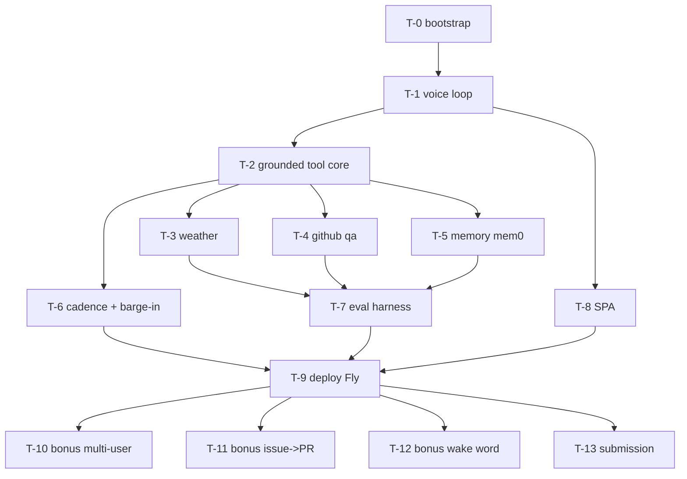

# Jarvis — Task Graph

`docs/tickets.json` is authoritative (hooks and Tasks ingestion read it).
This file is the human mirror.

## Dependency graph



## Sequencing (agentic-execution terms)

- Critical path: T-0 → T-1 → T-2 → {T-3/T-4/T-5} → T-7 → T-9 → T-13.
  ~1 focused Claude Code session per ticket; 14 tickets ≈ 14 session-units,
  compressible to ~9 sequential slots with parallelism below.
- **Parallel window after T-2 closes**: T-3, T-4, T-5, T-6, T-8 are
  parallel-safe (disjoint scopes). Max 3 concurrent worktrees.
  Suggested waves: wave 1 = T-4, T-5, T-8 (the heavy three);
  wave 2 = T-3, T-6.
- **Merge order (required)**: T-3 → T-4 → T-5 → T-6 → T-8. Rebase each
  worktree on the previous merge before merging.
- Bonuses execute strictly in priority order after T-9:
  T-10 → T-11 → T-12. T-13 (submission) claims last but does NOT wait for
  bonuses — submit with whatever is green.
- Mobile (R12) has no ticket by design. If T-10..T-12 all close early,
  ask Hank before drafting a mobile ticket.

## Tickets

See `docs/tickets.json` for the full contracts (objective, refs, acceptance,
verify, scope, depends_on, non_goals). Summary:

| ID | Outcome | Depends on | Parallel-safe |
|----|---------|------------|---------------|
| T-0 | Skeleton + harness + light CI green | — | no |
| T-1 | Voice loop end-to-end on LiveKit | T-0 | no |
| T-2 | Grounded tool-calling core + self-manifest | T-1 | no |
| T-3 | Weather grounded in live Open-Meteo | T-2 | yes |
| T-4 | GitHub Q&A with oversize degradation | T-2 | yes |
| T-5 | Cross-session memory via mem0/pgvector | T-2 | yes |
| T-6 | Fillers, barge-in, stop phrase | T-2 | yes |
| T-7 | Eval harness: 0 fabrications on approved set | T-3,4,5 | no |
| T-8 | Polished SPA with live transcript/state | T-1 | yes |
| T-9 | Deployed on Fly, smoke + latency report green | T-6,7,8 | no |
| T-10 | Bonus: Clerk multi-user + preferences | T-9 | no |
| T-11 | Bonus: issue→PR with audible progress | T-9 | no |
| T-12 | Bonus: wake word passive mode | T-9 | no |
| T-13 | Submission sent (video/docs/zip) | T-9 | no |

## Verify scope, and what covers the gap (T-24)

Every ticket's `verify` in `docs/tickets.json` is scoped to its own
slice of the repo by design — that's what keeps a ticket boundary
fast. Only two verify commands run the whole backend+frontend suite:
**T-0** (bootstrap) and **T-24** (this remediation). Every other
ticket's verify is deliberately narrow:

The table below is checked directly against `docs/tickets.json`'s
`verify` strings (26 entries, every ticket T-1..T-27 except T-24
itself) — not a paraphrase, so a bucket label can't silently drift
from what the command actually runs:

| ID | verify (from tickets.json) | Class |
|----|------|-------|
| T-1 | `pytest tests/pipeline -q` + ruff | backend, 1 dir |
| T-2 | `pytest tests/grounding -q` + ruff | backend, 1 dir |
| T-3 | `pytest tests/tools/test_weather.py -q` | backend, 1 **file** |
| T-4 | `pytest tests/tools/test_github.py -q` | backend, 1 **file** |
| T-5 | `pytest tests/memory -q` | backend, 1 dir |
| T-6 | `pytest tests/cadence -q` | backend, 1 dir |
| T-7 | `python -m evals.run --golden ... --require-approved` | standalone module, no pytest/vitest |
| T-8 | `npm run build && npm run test -- --run` | frontend only |
| T-9 | `bash scripts/smoke_deploy.sh` | standalone script, no pytest/vitest |
| T-10 | `pytest tests/multiuser -q` **+** `bash scripts/load_smoke.sh 10` | backend, 1 dir + non-pytest script companion |
| T-11 | `pytest tests/agent_pr -q` | backend, 1 dir |
| T-12 | `npm run test -- --run` | frontend only |
| T-13 | `bash scripts/verify_submission.sh` | standalone script, no pytest/vitest |
| T-14 | `pytest tests/pipeline -q` + ruff | backend, 1 dir |
| T-15 | `pytest tests/pipeline tests/cadence -q` + ruff | backend, **2 dirs** |
| T-16 | `pytest tests/pipeline -q` + ruff | backend, 1 dir |
| T-17 | `pytest tests/cadence tests/pipeline -q` + ruff | backend, **2 dirs** |
| T-18 | `pytest tests/grounding -q` + ruff | backend, 1 dir |
| T-19 | `pytest tests/grounding -q` **+** `python -m evals.run ... --client echo \|\| true` | backend, 1 dir + evals companion whose own failure is swallowed by `\|\| true` (only the pytest half can fail this verify) |
| T-20 | `bash .claude/hooks/tests/run_scope_guard_tests.sh` | hook test suite (bash), no pytest/vitest |
| T-21 | `bash .claude/hooks/tests/run_claim_tests.sh` | hook test suite (bash), no pytest/vitest |
| T-22 | `bash .claude/hooks/tests/run_evidence_tests.sh` | hook test suite (bash), no pytest/vitest |
| T-23 | `pytest tests/memory -q` **+** `bash scripts/tests/run_smoke_exit_code_tests.sh` | backend, 1 dir + non-pytest script companion |
| T-25 | `pytest tests/grounding -q` | backend, 1 dir |
| T-26 | `pytest tests/cadence -q` + ruff | backend, 1 dir |
| T-27 | `npm run build && npm run test -- --run` | frontend only |

None of these — including the "+ script companion" and "standalone
script" rows — run the full backend suite, the full frontend suite,
or both; every one of them can go green while a sibling test
elsewhere in the repo is broken. This is intentional, not an
oversight: a ticket verifying `tests/tools/test_weather.py` in under
a second is what makes per-ticket iteration cheap. T-24 closes the gap
that narrowness leaves, identically for all 26 rows above regardless
of class, in exactly one place:

**`.claude/hooks/verify_gate.sh`** (the `TaskCompleted` hook that
gates every ticket close) now runs a *second* check after a ticket's
own `$VERIFY` passes: the full regression suite —

```bash
cd backend && uv run pytest -q && uv run ruff check src && cd ../frontend && npm run -s test -- --run
```

If the ticket's own narrow verify passes but this fails, the hook
blocks completion (exit 2) — the ticket broke something outside its
declared scope and cannot close until that's fixed. This applies to
**every** ticket, regardless of what its own `verify` covers,
including the standalone-script and hook-suite tickets above.

**Measured cost** (this repo, 2026-08-14): backend `pytest -q` — 354
tests, ~12s; `ruff check src` — ~0s; frontend `npm run test -- --run`
— 68 tests across 10 files, ~2s. **Total ~15s wall-clock**, run once
per ticket completion. This is cheap enough to run at every boundary
and is unrelated to SPEC C7: C7 caps GitHub Actions (CI) cost, and
this check runs only in the local `TaskCompleted` hook, never in CI —
see CLAUDE.md §"CI reachability" for why `.github/workflows/ci.yml`
itself is decorative for this repo's actual submission path.

The regression check is guarded on `backend/` and `frontend/`
actually existing under `$CLAUDE_PROJECT_DIR`, so it is a deliberate
no-op inside `run_evidence_tests.sh`'s fabricated sandbox repo (which
has neither directory) — that suite exercises the receipt/staleness
contract, not this regression gate, on a throwaway repo with no real
code to regress.

**Fails loudly, not open, on a bad environment.** Before a ticket's
own `verify` is even looked up, `verify_gate.sh` checks that
`CLAUDE_PROJECT_DIR` is set, that `$CLAUDE_PROJECT_DIR/docs/tickets.json`
exists, and that it's valid JSON — and blocks (exit 2, with a message
naming the actual problem) if any of those fail, rather than letting
`$VERIFY` end up empty and silently allowing the close. This closes a
pre-existing hole where an unset or bogus `CLAUDE_PROJECT_DIR` made
the ticket-lookup `jq` call fail inside a `$(...)` substitution with
no `set -e` to propagate it — skipping both the ticket's own verify
and the regression suite above with no error at all. A ticket that
genuinely has no `verify` declared for its id still allows, unchanged.

## Priority batch — remediation (T-17–T-27)

Raised from defects observed while the T-0–T-16 build ran, each verified
  against the repository at the commit that introduced it and re-verified
  against HEAD before being written down. These carry `"priority": "next"` in
  `docs/tickets.json` and are claimed before the ascending-ID default. Two of them (T-17, T-18) describe
  defects that are live in the deployed product right now.

### T-17: A failed filler must not turn a successful lookup into a refusal
- **Objective**: FillerGate.guard()'s finally block suppresses only CancelledError, then
  awaits the timer task. If the filler coroutine raised (TTS hiccup, audio
  device, Cartesia stream), that exception replaces the tool's return
  value. tools_wiring catches it and builds ToolResult(data={},
  error=...), which usable_results() discards, so
  has_supporting_evidence() is False and synthesize_grounded returns
  REFUSAL: the user hears "I don't know" about a fact the system
  successfully retrieved. Dormant until T-15 put guard() on the live path;
  with weather p50 2663ms and github p50 1648ms every heavy turn now
  crosses FILLER_THRESHOLD_MS, so the filler path runs constantly.
  Reproduced against committed code. gate.decide() is also dead here: zero
  call sites in src/, duplicating the live timer rule so a future fix can
  land in one copy and not the other.
- **Refs**: R2, R6, OBS#G5, OBS#G4, DESIGN#interfaces
- **Acceptance**: 1) A filler player that raises leaves guard()'s return value intact: the
  awaited tool result is returned unchanged and the exception is logged,
  never propagated; 2) A test drives guard() with a player that raises and
  asserts the tool's real value is returned - the existing tests all use a
  player that always succeeds, so this direction is currently unexercised;
  3) An integration test through tools_wiring asserts a heavy tool whose
  filler fails still yields a usable ToolResult (non-empty data, error
  None) and therefore does NOT produce REFUSAL; 4) Cancellation semantics
  are unchanged: cancelling guard() still cancels the timer and still
  raises CancelledError to the caller, and the existing no-leak tests
  still pass unmodified; 5) gate.decide() is either deleted with its
  export, or called by _speak_after_delay so one rule governs both paths -
  not left as a second unreferenced copy
- **Verify**: `cd backend && uv run pytest tests/cadence tests/pipeline -q && uv run ruff check src`
- **Scope**: `backend/src/jarvis/cadence/**`, `backend/tests/cadence/**`,
  `backend/src/jarvis/pipeline/tools_wiring.py`,
  `backend/tests/pipeline/**`
- **Depends on**: none
- **Non-goals**: No change to the pinned FILLER_THRESHOLD_MS / FILLER_START_DEADLINE_MS
  values; No change to the at-most-one-filler-per-guard-call contract;
  Does not weaken the broad handler except in tools_wiring - a genuinely
  broken handler must still degrade to an error ToolResult. Not
  `parallel_safe`.

### T-18: Size the synthesis token budget for an adaptive-thinking TOOL_MODEL
- **Objective**: llm/synthesis.py pins _MAX_TOKENS = 1024 and passes no thinking parameter.
  On claude-sonnet-4-6 omitting thinking meant thinking off, so all 1024
  tokens went to the answer. TOOL_MODEL is now claude-sonnet-5, where
  omitting thinking runs adaptive thinking by default and max_tokens caps
  thinking plus response text together. Every heavy-tool turn escalates to
  TOOL_MODEL per route_model(), so grounded answers on exactly the turns
  that carry real tool data can truncate mid-sentence. A truncated answer
  that loses its required fact scores missing_include in the eval, so this
  surfaces as an unexplained grounding failure rather than a token-budget
  one.
- **Refs**: R6, R6a, OBS#G1, DESIGN#interfaces
- **Acceptance**: 1) _MAX_TOKENS gives an adaptive-thinking model room for thinking plus a
  complete grounded answer; the chosen value and its reasoning are
  recorded in a comment naming the adaptive-thinking interaction; 2) A
  test asserts synthesize_grounded's request carries a max_tokens large
  enough that a representative grounded answer plus thinking fits - the
  fake ModelClient records the value, so this needs no network; 3) The
  eval is re-run and docs record that no case regressed to missing_include
  for truncation reasons; 4) If a thinking parameter is passed instead of
  raising the budget, it is verified valid for BOTH $CONVO_MODEL and
  $TOOL_MODEL, since one complete() serves both
- **Verify**: `cd backend && uv run pytest tests/grounding -q && uv run ruff check src`
- **Scope**: `backend/src/jarvis/llm/**`, `backend/tests/grounding/**`
- **Depends on**: none
- **Non-goals**: No hardcoded model ids - routing stays $CONVO_MODEL / $TOOL_MODEL only
  (SPEC C3); No change to the pinned synthesize_grounded signature or
  ToolResult shape. `parallel_safe`.

### T-19: Bind the grounded negative-fact rule with a test and an unambiguous golden case
- **Objective**: fd5b88b added the rule that a fact the data establishes NEGATIVELY
  (absent, zero, a listed limitation) is a supported ANSWER rather than a
  refusal. Nothing binds it: tests/grounding/test_policy.py contains four
  substring assertions that pass identically before and after the change,
  the suite count did not move, and no golden case exercises the
  behaviour. Separately, golden case G-004 asks the chance of rain on
  2026-08-18 with must_include ['27'], but '27' matches two distinct facts
  in its own fixture - precipitation_probability_max[5] = 27 (the correct
  answer) and temperature_2m_max[4] = 27.0 (a different field on a
  different day) - so an answer citing the wrong field scores pass.
- **Refs**: R6, R6a, OBS#G2, OBS#G3
- **Acceptance**: 1) A test asserts ANSWER_POLICY carries the negative-fact rule in a way
  that fails if the paragraph is removed - not a bare substring check that
  any prose would satisfy; 2) At least one golden case has kind grounded /
  expect answer over a fixture whose data answers NEGATIVELY (zero,
  absent, or an explicit limitation), with must_include pinning the
  negative answer and must_not_include pinning the REFUSAL prefix; 3)
  G-004 is disambiguated so exactly one fact in its fixture can satisfy
  must_include - either by making the colliding value unique or by pinning
  a longer, unambiguous substring; 4) A scripted check over golden.jsonl
  asserts no case's must_include substring appears more than once across
  distinct fields of that case's own fixture, so this class of ambiguity
  cannot silently return; 5) The golden set's _meta approved_by /
  approved_at are NOT set by this ticket - changing the set means it needs
  Hank's review again
- **Verify**: `cd backend && uv run pytest tests/grounding -q && uv run python -m evals.run --golden evals/golden.jsonl --max-fabrications 0 --client echo || true`
- **Scope**: `backend/src/jarvis/llm/policy.py`, `backend/tests/grounding/**`,
  `backend/evals/**`
- **Depends on**: none
- **Non-goals**: Does not sign off the golden set on a human's behalf; No change to the
  REFUSAL literal or the pinned scoring verdict names. Not
  `parallel_safe`.

### T-20: The scope guard covers every write path, and stops guarding the plan away
- **Objective**: settings.json registers scope_guard.sh under matcher 'Edit|Write' only, so
  any write performed through Bash - sed -i, a heredoc, cp, git checkout -
  bypasses the ticket boundary entirely. scope_guard.sh line 11 then
  exempts .claude/* and docs/*, which is precisely docs/tickets.json,
  SPEC.md and DESIGN.md: the files protocol rule 1 exists to protect are
  the ones the guard waves through. Its path normalisation also leaves an
  absolute path unchanged when the target is outside CLAUDE_PROJECT_DIR,
  so every write to a scratch or temp directory is denied while a ticket
  is claimed. Finally the jq glob to regex translation appends '$' but no
  '^', so test() searches rather than full-matches and a path merely
  containing a scope prefix passes.
- **Refs**: OBS#W2, OBS#W3, OBS#W4, OBS#W5, CLAUDE.md#rules
- **Acceptance**: 1) The guard is reached for Bash-mediated writes, or the protocol
  documents in CLAUDE.md that Bash is deliberately outside the boundary
  and why - silent bypass is not an acceptable resting state; 2) docs/ is
  no longer blanket-exempt: an edit to docs/tickets.json, docs/SPEC.md or
  docs/DESIGN.md is denied unless the active ticket's scope lists it; 3) A
  path outside CLAUDE_PROJECT_DIR is allowed rather than denied - the
  guard constrains work inside the repo, it does not own the filesystem;
  4) The generated regex is anchored at both ends, so
  'vendor/backend/src/jarvis/cadence/x.py' does not satisfy a
  'backend/src/jarvis/cadence/**' scope; 5) A test script exercises the
  hook directly with representative allowed and denied paths for at least
  three tickets, and runs in CI
- **Verify**: `bash .claude/hooks/tests/run_scope_guard_tests.sh`
- **Scope**: `.claude/hooks/**`, `.claude/settings.json`, `CLAUDE.md`,
  `.github/workflows/**`
- **Depends on**: none
- **Non-goals**: Does not loosen any ticket's declared scope to make current work legal;
  Does not disable the guard as a way of passing its own tests. Not
  `parallel_safe`.

### T-21: Ticket claims are session-scoped and carry an owner
- **Objective**: .claude/active-ticket holds a bare ticket id and nothing else, so both
  guards key off repo-global state with no notion of who claimed it.
  stop_guard.sh therefore blocks every session in the repo from stopping
  while any ticket is open - including a read-only observer session that
  claimed nothing - and offers only finish, revert, or release, none of
  which a non-owner may safely do. scope_guard.sh has the mirror problem:
  with a claim active it constrains sessions that do not own it, and with
  no claim at all it permits everything. Protocol rule 9 contemplates
  three concurrent agents in worktrees, which neither guard can
  distinguish.
- **Refs**: OBS#W1, OBS#W10, OBS#W14, CLAUDE.md#rules
- **Acceptance**: 1) A claim records an owner identifier alongside the ticket id, written
  when the ticket is claimed; 2) stop_guard.sh blocks only the session
  that owns the claim; a session that owns no claim stops without being
  blocked; 3) scope_guard.sh applies a ticket's scope only to the owning
  session; 4) Guards behave safely when no claim exists: a missing active-
  ticket does not silently disable the scope boundary for a session that
  does hold work; 5) A test exercises both guards for owner and non-owner
  sessions and runs in CI
- **Verify**: `bash .claude/hooks/tests/run_claim_tests.sh`
- **Scope**: `.claude/hooks/**`, `.claude/settings.json`, `CLAUDE.md`,
  `.github/workflows/**`
- **Depends on**: T-20
- **Non-goals**: No change to the one-ticket-at-a-time rule; Does not introduce a lock
  server or any external coordination service. Not `parallel_safe`.

### T-22: Evidence binds to the commit it certifies
- **Objective**: verify_gate.sh writes a bare epoch timestamp to
  .claude/evidence/<T-id>.pass and nothing else, so a receipt records when
  a ticket passed but not what it passed. Reopening a ticket silently
  invalidates it: T-2.pass is stamped 06:27 while its last change is
  fd5b88b at 15:37, and T-6.pass is stamped 09:27 while its filler rebuild
  landed at 22:18. Both receipts now attest to code that no longer exists
  - T-6's describes macOS-say clips replaced hours ago. T-13's submission
  checklist consumes this directory, so the submission can report green
  against superseded work.
- **Refs**: OBS#W9, OBS#G-evidence, CLAUDE.md#rules
- **Acceptance**: 1) A .pass receipt records the HEAD sha it was produced at, alongside the
  timestamp; 2) A check reports any ticket whose last touching commit is
  newer than its receipt, and names them; 3) That check is part of T-13's
  submission verification, so a stale receipt cannot report green; 4) Re-
  running verify for a reopened ticket refreshes the receipt; the stale
  receipts for T-2 and T-6 are regenerated or explicitly reported as stale
  by this ticket's own check
- **Verify**: `bash .claude/hooks/tests/run_evidence_tests.sh`
- **Scope**: `.claude/hooks/**`, `scripts/**`, `.github/workflows/**`
- **Depends on**: none
- **Non-goals**: Does not re-run or re-verify other tickets' work as a side effect; Does
  not delete existing receipts. `parallel_safe`.

### T-23: A skipped check is never a passing check
- **Objective**: scripts/smoke_deploy.sh degrades to success when its hardest check cannot
  run: SKIPs do not affect the exit code, so with flyctl unauthenticated
  the worker-registration check skips and the script exits 0 having
  verified only the web process - the component the ticket is about goes
  unchecked while the gate reads green. T-9's own commit describes the
  adjacent failure, that a crash-looping machine still reports state
  started, so a machine-state check could not see the OOM. The same shape
  appears in tests/memory/conftest.py, where require_db calls pytest.skip
  when Postgres is unreachable: the memory integration suite vanishes with
  no failure, and a green run means two different things depending on the
  machine.
- **Refs**: R1, OBS#W-skip, OBS#G7, SPEC#C7
- **Acceptance**: 1) smoke_deploy.sh exits non-zero when a check could not be performed
  against a target that is supposed to be deployed - unrunnable is a
  failure, not a pass; 2) The worker check verifies the worker is serving
  rather than merely present: a crash-looping or capacity-starved machine
  does not satisfy it; 3) A run with no credentials and a run against a
  healthy deployment are both covered by a test of the script's own exit-
  code logic; 4) The memory suite's skip is loud: a run where the database
  was unreachable cannot be reported as a clean pass, and the summary
  states which suites were skipped; 5) docs record which checks require
  which credentials, so a green local run's meaning is unambiguous
- **Verify**: `cd backend && uv run pytest tests/memory -q && bash scripts/tests/run_smoke_exit_code_tests.sh`
- **Scope**: `scripts/**`, `backend/tests/memory/**`, `docs/**`
- **Depends on**: none
- **Non-goals**: Does not require CI to provision Postgres or Fly - SPEC C7 caps CI cost;
  Does not delete the skip; it makes the skip visible and non-passing. Not
  `parallel_safe`.

### T-24: Verify commands cover their blast radius, and CI actually runs
- **Objective**: Every ticket verify from T-1 onward is scoped to its own subdirectory, so
  a ticket can go green while breaking a sibling's tests; only T-0 runs
  the whole suite. The full suite and ruff live in
  .github/workflows/ci.yml, which triggers on pull_request - and the repo
  has zero git remotes and one branch, so that workflow has never executed
  once. The cross-ticket regression gate the project believes it has does
  not exist in either place.
- **Refs**: OBS#W6, OBS#W7, SPEC#C7, CLAUDE.md#rules
- **Acceptance**: 1) Closing any ticket runs a check that would fail if the change broke a
  test outside that ticket's scope; 2) That check is cheap enough to run
  at every ticket boundary and does not violate SPEC C7's CI cost cap; 3)
  The CI workflow is reachable: either a remote and PR flow exist, or the
  workflow triggers on something this repo actually does, or CLAUDE.md
  states plainly that CI is decorative and names the local command that
  replaces it; 4) docs/TASKS.md records which verify commands are narrow
  by design and what covers the gap
- **Verify**: `cd backend && uv run pytest -q && uv run ruff check src && cd ../frontend && npm run -s test -- --run`
- **Scope**: `.github/workflows/**`, `docs/**`, `CLAUDE.md`, `.claude/hooks/**`
- **Depends on**: none
- **Non-goals**: Does not add CI jobs, matrices, or e2e runs - SPEC C7 is a hard
  constraint; Does not widen any existing ticket's verify command
  retroactively. Not `parallel_safe`.

### T-25: Machine-enforce the golden-set human approval gate
- **Objective**: T-7's acceptance 2 requires a human's review of evals/golden.jsonl,
  recorded in the _meta header. verify_gate.sh runs one command -
  evals.run - which reads the cases and never inspects approved_by, so the
  ticket's gate is structurally incapable of checking its own acceptance
  criterion. The project's R6a claim is that the golden set is EXTERNAL
  ground truth; nothing in the harness distinguishes an externally
  reviewed set from one signed in place.
- **Refs**: R6a, OBS#W8, SPEC#T-7-human-gate
- **Acceptance**: 1) evals.run exits NON-ZERO while _meta.approved_by or _meta.approved_at
  is empty, unless explicitly asked for a draft run; 2) The non-zero path
  cannot be bypassed by a flag, env var, or argument that a build agent
  would reach for; a draft run is obtained by an explicit, clearly-named
  draft mode that prints that its result is not evidence; 3) Tests cover
  both directions using a SYNTHETIC approved fixture in tmp_path; the real
  evals/golden.jsonl is never modified by the test; 4) docs/tickets.json
  T-7 verify is updated to assert approval, so the gate and the acceptance
  criterion agree; 5) This ticket never sets approved_by or approved_at,
  and never edits evals/golden.jsonl - it exists to protect the gate, not
  to pass through it
- **Verify**: `cd backend && uv run pytest tests/grounding -q`
- **Scope**: `backend/evals/**`, `backend/tests/grounding/**`, `docs/tickets.json`
- **Depends on**: none
- **Non-goals**: Does not approve the golden set; Does not change any case's content or the
  scoring verdicts. Not `parallel_safe`.

### T-26: Package-safe asset resolution and runtime-output hygiene
- **Objective**: cadence/fillers.py resolves ASSETS_DIR as
  Path(__file__).resolve().parents[3] / 'assets' / 'fillers', which is
  correct only when the package is run from the source tree; installed as
  a wheel the parent chain differs and the filler bank cannot load, so
  T-15's cadence silently degrades in exactly the container T-9 deploys.
  Separately backend/var/ has no ignore rule and backend/var/latency.jsonl
  is now tracked, so per-run telemetry churns in every diff and would ride
  into T-13's submission zip. The same gap covered .gstack/ earlier:
  .gitignore has rules for .venv/, dist/, .env*, .claude/evidence/ and
  .DS_Store, but none for runtime output.
- **Refs**: OBS#G6, OBS#G8, R2, SPEC#C7
- **Acceptance**: 1) Filler assets resolve correctly both from a source checkout and from an
  installed distribution; a test asserts resolution does not depend on the
  parent-directory depth of __file__; 2) The deployed image is shown to
  load the filler bank - a container or import-path test, not only a local
  run; 3) backend/var/ and other runtime output directories are
  gitignored, and backend/var/latency.jsonl is untracked without losing
  the committed measurement history referenced by docs/latency-report.md;
  4) docs state where deployed latency records are collected from, since
  latency_report.py's default input is a local repo path that deployed
  runs never write to
- **Verify**: `cd backend && uv run pytest tests/cadence -q && uv run ruff check src`
- **Scope**: `backend/src/jarvis/cadence/**`, `backend/tests/cadence/**`, `.gitignore`,
  `scripts/**`, `docs/**`
- **Depends on**: none
- **Non-goals**: No change to the pinned filler manifest schema or the phrase list; Does
  not rebuild the filler audio. `parallel_safe`.

### T-27: Assert the agent-state wire vocabulary cannot drift between backend and SPA
- **Objective**: The pinned wire vocabulary is declared twice and nothing asserts the two
  agree: backend/src/jarvis/pipeline/events.py defines WireAgentState /
  _WIRE_STATES, frontend/src/lib/types.ts defines AgentState /
  AGENT_STATES. Both currently list the same four states, so the drift is
  latent rather than present - but adding a fifth state on one side is a
  one-line change that no test would catch, and the SPA's parser returns
  null for an unknown state, so the symptom would be a silently missing UI
  transition rather than an error. This matters more since 552d769: for
  the whole build before it, publish_data was never awaited, so the
  frontend consumed a channel that produced nothing and no test on either
  side would have noticed. Both sides are otherwise well covered -
  frontend/src/lib/types.test.ts exercises parseJarvisEvent across all
  four states and malformed payloads, and
  frontend/src/hooks/useJarvisSession.test.tsx covers the pinned
  transcript merge rule - so this ticket adds the one assertion neither
  suite can make alone.
- **Refs**: R5, OBS#G-wire-drift, DESIGN#interfaces
- **Acceptance**: 1) A check asserts the frontend's AGENT_STATES and the backend's
  _WIRE_STATES contain exactly the same members, and fails if either side
  gains, loses, or renames a state; 2) The check reads both definitions
  from their source of truth rather than restating the list a third time -
  a hardcoded copy inside the test would be a fourth place to drift; 3)
  The check runs in an existing verify command for one of the two sides,
  so no new CI job is added (SPEC C7); 4) A deliberate mismatch is shown
  to fail the check - demonstrated in the ticket's commit message or a
  temporary local edit, not left as an untested assertion; 5) The frontend
  production bundle warning (686kB > Vite's 500kB threshold at last
  measurement) is either resolved or recorded in docs with the reason it
  is acceptable for this deliverable
- **Verify**: `cd frontend && npm run -s build && npm run -s test -- --run`
- **Scope**: `frontend/**`, `backend/src/jarvis/pipeline/events.py`, `scripts/**`,
  `docs/**`
- **Depends on**: none
- **Non-goals**: No redesign of the SPA and no change to the pinned wire event shapes; Does
  not add a CI job or matrix - SPEC C7 is a hard constraint; Does not
  restate the state list anywhere it is not already defined.
  `parallel_safe`.

## Priority batch — post-build hardening (T-28–T-34)

Raised by the 2026-08-14 monitor session from an adversarially-verified
  audit of the T-17..T-27 batch and the finished build: every objective
  below was confirmed against HEAD (each finding re-checked by an
  independent skeptic pass, and the verify commands re-run) before being
  written down. These carry `"priority": "next"` in `docs/tickets.json`.
  None are `parallel_safe`, and the order is ENFORCED as a `depends_on`
  chain (T-28 -> T-29 -> ... -> T-34), so the ready set is always exactly
  one ticket. The per-ticket sections below are GENERATED from
  `docs/tickets.json` — edit the JSON, not this prose.

Provenance tags used in `refs`:
- **MON#1** — T-19's pinned verify ends `|| true` (exits 0 unconditionally;
  its eval leg genuinely exits 1 at HEAD); no lint guards verify strings.
- **MON#2** — the approval gate proves presence, not currency: T-19's
  post-approval golden edits passed every gate until noticed by hand.
- **MON#3** — filler assets duplicated; `build_fillers.py` still writes
  only the unpackaged path, so a rebuild strands the packaged copy.
- **MON#4** — `JARVIS_MEMORY_TESTS_REQUIRE_DB` has no setter anywhere;
  unreachable pgvector still exits 0 at machine level.
- **MON#5** — worker-liveness probe silently skips unparseable exit-event
  timestamps (fail-open); T-23's claimed wrong-shape probes were never
  committed, and adjacent wrong shapes fail only via an unnamed crash.
- **MON#6** — real-model eval evidence exists only as commit-message
  prose; `--json` report plumbing exists unused.
- **MON#7** — no evidence receipt for T-22 (closed) or T-13 (cannot close
  yet); the submission gate has no MISSING classification.

Human prerequisites (not tickets — nothing in-repo can do these):
- `flyctl auth login` — unblocks T-9 live re-verification and T-32's
  live-fixture capture.
- Cartesia billing (HTTP 402) — unblocks the T-16 R1 measurement, the
  demo video, and any future filler rebuild (T-30 explicitly excludes it).
- T-13 submission send — Hank's call, per its completion commit.
- T-29's minted `approved_sha256` needs Hank's confirmation.

Deliberately NOT ticketed (recorded so it isn't re-litigated): T-22's
  scope-granularity residual — broad scope globs (T-0 ≈ whole repo) make
  fingerprint staleness noisy. Fixing it means retroactive scope surgery
  on closed tickets in `docs/tickets.json` for diagnostic polish only;
  the `reopened` vs `changed-by-a-different-ticket` labels already keep
  the output readable.

### T-28: T-19's verify can actually fail, and no verify string can neuter itself
- **Objective**: T-19's pinned verify ends "--client echo || true": shell
  left-associativity makes the whole command exit 0 even when its pytest leg
  fails, and the inner eval leg genuinely exits 1 at HEAD (the echo client
  mirrors each fixture, tripping exactly 10 content guards against
  --max-fabrications 0 -- a known, stable outcome the pinned string discards).
  Confirmed still true after the T-17..T-27 batch: the chore that fixed T-23's
  string left T-19's untouched, and T-24's enumeration documented the
  neutering without repairing it (a deliberate no-retroactive-edit choice
  recorded in its completion commit). Nothing lints verify strings, so this
  class -- unconditional-success tails, cwd-leaking cd across && (both
  observed this build) -- can return with any future plan edit.
- **Refs**: R6a, MON#1
- **Acceptance**: 1) T-19's re-pinned verify exits nonzero when its pytest leg
  fails (demonstrated with a temporary local red test, then reverted) and
  nonzero when the echo eval's outcome deviates from its pinned expectation;
  no || true or equivalent unconditional-success tail remains in it; 2) The
  echo leg stays honest per SPEC R6a: it asserts the harness's known echo
  outcome as a SELF-TEST (the stable fabrication set), keeps the existing
  not-evidence-of-grounding labeling, and is never presented as grounding
  evidence; 3) A verify-string lint runs inline in verify_gate.sh before any
  ticket's verify executes, and verify_gate fails CLOSED if the lint cannot
  run. The rules, pinned mechanically: reject unconditional-success tails (||
  true, ; true, || :), and reject an unparenthesized cd whose effect crosses
  && into a later leg that references a repo-root-relative path (scripts/,
  docs/, .claude/, frontend/) -- the T-23 defect shape; a single leading cd
  whose later legs stay inside that directory is conformant, so the ~20 legacy
  'cd backend && ...' strings pass unchanged. Hook tests drive the lint with
  at least one failing fixture per rule, plus all 35 current strings passing
  after T-19's fix; 4) Only T-19's verify string is edited in
  docs/tickets.json -- every other ticket's verify is byte-identical -- and
  both places docs/TASKS.md restates T-19's string (its T-19 section and the
  T-24 verify-coverage enumeration) are updated to the re-pinned string in the
  same commit; the lint only ADDS failure modes to the gate; 5) The two
  T-22-era sandbox assertions in .claude/hooks/tests/run_evidence_tests.sh
  that pin the old permissive behavior (the T-19-shaped '|| true' case and the
  T-23-shaped cd case, both currently asserted as allowed) are updated to
  expect lint rejection; if any lint code lives outside verify_gate.sh, the
  sandbox copy step is updated in the same change so the sandboxed gate still
  runs it
- **Verify**: `bash .claude/hooks/tests/run_verify_lint_tests.sh && bash .claude/hooks/tests/run_evidence_tests.sh`
- **Scope**: `docs/tickets.json`, `docs/TASKS.md`, `.claude/hooks/**`,
  `backend/evals/**`, `backend/tests/grounding/**`
- **Depends on**: none
- **Non-goals**: No other verify string is changed; No change to the REFUSAL
  literal or pinned scoring verdict names; Does not attempt to make the echo
  eval a grounding gate -- real-model evidence is T-33's job. Not
  `parallel_safe`.

### T-29: Golden-set approval binds to the bytes it approved
- **Objective**: T-25's gate proves _meta.approved_by/approved_at are present
  and non-blank -- not that the approval covers the current content.
  Demonstrated live this build: T-19 edited the set after the 2026-08-13
  approval (new G-038, tightened G-004) and every gate stayed green until
  out-of-band monitoring surfaced it; the 2026-08-14 re-approval (362f95a) is
  likewise bound to nothing, so the next edit repeats the cycle. Bind approval
  to content: _meta.approved_sha256 over the approved bytes (golden.jsonl
  normalized minus the _meta line); mismatch or absence fails the gate with
  the remedy named. Same audit, secondary hygiene: test_golden_ambiguity's
  number/url alias exemption accepts the number as ANY path segment of the
  url, so /orgs/42/repo/pull/999 would wrongly exempt an unrelated 42.
- **Refs**: R6, R6a, MON#2
- **Acceptance**: 1) The approval gate fails with a distinct exit code and
  remedy text when golden.jsonl's current content hash differs from
  _meta.approved_sha256, and treats a missing hash on an otherwise-approved
  set the same way -- unverifiable is never current; 2) A helper prints the
  canonical hash for a human to paste; no code path ever writes
  approved_sha256 into golden.jsonl (T-25's no-signing non-goal carried
  forward). The executing agent performs the one-time mechanical edit
  inserting the minted hash for the currently approved 2026-08-14 content --
  required for the gate and the unmodified T-25 tests to pass against the real
  file -- and Hank's confirmation of that exact value is requested in the
  completion report; 3) Existing T-25 approval-gate tests pass unmodified; new
  tests cover match, mismatch, and missing-hash via tmp_path sets and never
  edit the real golden.jsonl beyond the single _meta hash insertion above (the
  autouse byte-compare fixture pattern already in test_approval_gate.py); 4)
  The number/url exemption merges a number/url pair only when the number is
  the url's identifying segment, with a test that fails against the old
  any-segment rule
- **Verify**: `(cd backend && uv run pytest tests/grounding -q && uv run ruff check src)`
- **Scope**: `backend/evals/**`, `backend/tests/grounding/**`
- **Depends on**: T-28
- **Non-goals**: No golden case content changes; No claim of authenticity
  beyond content binding -- a human still owns 'approved'; No change to pinned
  scoring verdict names. Not `parallel_safe`.

### T-30: One filler-asset source of truth
- **Objective**: T-26 fixed packaging by copying the six clips and manifest
  into backend/src/jarvis/cadence/assets/fillers/, leaving the originals at
  backend/assets/fillers/ -- and scripts/build_fillers.py still writes ONLY
  the old location (_DEFAULT_OUT_DIR = <repo>/backend/assets/fillers), so the
  first voice rebuild strands the packaged copy stale. T-26's divergence test
  turns that drift into a red suite, but nothing repairs it and the
  duplication is permanent load. Also stale: build_fillers.py's docstring
  cites the manifest schema as pinned in .claude/scratch/t6-contract.md, a
  path not in the tree.
- **Refs**: R2, MON#3
- **Acceptance**: 1) build_fillers.py's default output is the packaged
  location production actually loads
  (backend/src/jarvis/cadence/assets/fillers/, via _resolve_assets_dir());
  backend/assets/fillers/ is deleted or reduced to an explicitly gitignored
  scratch target, and nothing in src/ or tests/ references it -- the
  pipeline-side references (cadence_wiring.py and test_cadence_wiring.py) are
  in scope for exactly this; if the gitignored-scratch option is taken, the
  ignore entry lives in a nested backend/assets/.gitignore, since the root
  .gitignore is out of scope; 2) The T-26 divergence test is retired or
  repointed so the suite encodes one-canonical-copy rather than
  two-copies-agree; the packaged copy's integrity checks (manifest matches
  files, bytes load into FillerBank) are not weakened; 3) The manifest schema
  pointer names an in-repo location, not .claude/scratch/; 4) No audio bytes
  change: the six packaged clips and the manifest are byte-identical before
  and after this ticket
- **Verify**: `(cd backend && uv run pytest tests/cadence tests/pipeline -q && uv run ruff check src)`
- **Scope**: `scripts/**`, `backend/src/jarvis/cadence/**`,
  `backend/tests/cadence/**`, `backend/src/jarvis/pipeline/**`,
  `backend/tests/pipeline/**`, `backend/assets/**`, `docs/**`
- **Depends on**: T-29
- **Non-goals**: No clip regeneration -- Cartesia is returning HTTP 402
  (billing), and rebuilding voices is not this ticket; No change to the
  FillerBank loading contract or the pinned filler phrases. Not
  `parallel_safe`.

### T-31: The memory-DB hard-fail flag has a real setter
- **Objective**: JARVIS_MEMORY_TESTS_REQUIRE_DB=1 turns an unreachable
  pgvector into a hard failure (backend/tests/memory/conftest.py:95) -- but
  nothing anywhere sets it: no workflow, hook, or script exports it, and the
  conftest text implying a deployed/CI gate context sets it is currently
  false. Confirmed empirically: the memory suite against an unreachable
  database exits 0 (15 passed, 9 skipped) with a red banner no machine reads.
  T-23 made the skip loud at human level; at machine level the pass is still
  silent, which is the exact defect class T-23 existed to end.
- **Refs**: MON#4
- **Acceptance**: 1) Exactly one owning context is wired: verify_submission.sh
  GAINS a memory check (it has none today) that runs the suite with
  JARVIS_MEMORY_TESTS_REQUIRE_DB=1, so the submission gate never tolerates an
  unverified memory path; local ticket verifies stay tolerant so an offline
  machine can still close unrelated tickets; 2) A script test proves the wired
  context fails on an unreachable database and passes with a reachable one --
  the reachable case may be simulated by a stubbed suite inside the sandbox
  project dir, per the harness's existing stub convention, since the subject
  is verify_submission.sh's flag wiring and exit-code plumbing, not live DB
  connectivity -- driving the real verify_submission.sh code path (sandbox
  project-dir argument); 3) The conftest comment names the actual setter, and
  docs record which gate requires the database and what credentials it needs;
  4) Existing memory test modules remain byte-for-byte unmodified; the only
  in-package edit is the conftest.py comment correction required by the
  previous item
- **Verify**: `(cd backend && uv run pytest tests/memory -q) && bash scripts/tests/run_require_db_wiring_tests.sh`
- **Scope**: `scripts/**`, `backend/tests/memory/**`, `docs/**`
- **Depends on**: T-30
- **Non-goals**: Does not make local ticket verifies require a database; No
  change to the memory implementation or its test modules. Not
  `parallel_safe`.

### T-32: The worker-liveness probe fails closed on shape drift
- **Objective**: T-23's rebuilt worker check parses flyctl machine list -j
  with an audit-confirmed fail-open branch: an exit event whose timestamp is
  missing or unparseable is silently skipped, so exactly the signal the check
  exists for -- a recent crash -- can vanish behind a green verdict. Adjacent
  wrong shapes fail only by accident: events as a dict or a non-dict event
  entry crashes the embedded parser, and the shell catch-all converts the
  crash into an unhelpful 'no parseable verdict' failure rather than a named
  one. T-23's completion commit claimed three wrong-JSON-shape probes 'fail
  loudly', but zero are committed (they were ad-hoc dev-time checks), so this
  regression class is unguarded. The field shape has never been validated
  against a live authenticated flyctl -- auth remains a human-blocked
  prerequisite.
- **Refs**: MON#5
- **Acceptance**: 1) An exit event with a missing or unparseable timestamp
  makes the probe report UNKNOWN/fail -- proven to invert against the old
  silent-skip behavior; events as a non-list and a non-dict entry in events[]
  produce an explicit UNKNOWN/fail with a named reason instead of a
  crash-derived verdict; a machine entry missing state continues to fail as it
  does today; legitimately absent non-exit events remain fine; 2) Wrong-shape
  probe cases are committed into scripts/tests/run_smoke_exit_code_tests.sh
  (at minimum: events as a dict, exit event with a garbage timestamp, machine
  entry missing state); the garbage-timestamp case is the one proven to invert
  against the old behavior, the others assert the named-reason failure; 3) The
  stable-window and Fly-checks requirements from T-23 are unchanged and no
  existing harness case is weakened; 4) docs/ops-smoke-test.md gains the
  one-step instruction for capturing a sanitized live fixture on first
  authenticated run, and the harness accepts such a fixture as an additional
  case when present
- **Verify**: `bash scripts/tests/run_smoke_exit_code_tests.sh`
- **Scope**: `scripts/**`, `docs/**`
- **Depends on**: T-31
- **Non-goals**: No live flyctl call in verify -- authentication is a
  human-blocked prerequisite; No change to T-23's credential-failure semantics
  (unauthenticated still hard-fails). Not `parallel_safe`.

### T-33: Real eval runs leave committed artifacts
- **Objective**: T-18 and T-19 both cite real-Anthropic eval results (PASS: 37
  and 38 cases respectively, 0 fabrications, ...) that exist nowhere but
  commit-message prose -- the audit could not verify either from the repo, and
  T-18's acceptance-3 half about docs recording the re-run is still unmet at
  HEAD because its scope had no docs path. The plumbing already exists unused:
  evals.run supports --json (run.py) and _write_json_report writes a full
  structured report. Make committed artifacts the convention and retire
  commit-prose as eval evidence.
- **Refs**: R6, R6a, MON#6
- **Acceptance**: 1) A fresh real-model eval (default Anthropic client, models
  from $CONVO_MODEL/$TOOL_MODEL routing) over the re-approved golden set runs
  with --json and the report is committed at docs/evals/latest.json; the
  summary shows 0 fabrications, 0 wrong refusals, 0 missing includes, 0
  errors, or the failure is surfaced to the human rather than retried into
  silence; 2) docs/evals/README.md names the convention -- every real run
  writes a JSON report, committed with the change it evidences -- and points
  at the latest report; T-18's outstanding docs-half is explicitly satisfied
  by reference to it; 3) scripts/check_eval_report.py validates the committed
  report's schema and zero-failure summary so a hand-edited or truncated
  report cannot pass; it is stdlib-only, since the verify runs it under bare
  python3 outside the uv environment; 4) golden.jsonl is untouched and no
  model id is hardcoded anywhere
- **Verify**: `(cd backend && uv run pytest tests/grounding -q) && python3 scripts/check_eval_report.py docs/evals/latest.json`
- **Scope**: `backend/evals/**`, `docs/**`, `scripts/**`
- **Depends on**: T-32
- **Non-goals**: No API keys or secrets committed; No golden-set edits and no
  eval logic changes beyond report plumbing. Not `parallel_safe`.

### T-34: A missing receipt is a loud state, and every closed ticket has one
- **Objective**: .claude/evidence/ holds fingerprint receipts for every ticket
  that has closed except one -- T-22, the ticket that invented fingerprinting,
  which never minted its own -- plus T-13, which has no receipt because it
  legitimately cannot close yet (human-blocked, per its completion commit).
  verify_submission.sh's freshness gate (seeded by T-22) judges receipts that
  exist; a ticket with NO receipt must be its own explicit failure class,
  distinguished from STALE/UNVERIFIABLE, and mapped to the documented
  human-action list when that is the true cause -- otherwise absence reads as
  either an opaque failure or nothing at all.
- **Refs**: MON#7
- **Acceptance**: 1) verify_submission.sh enumerates every ticket id in
  docs/tickets.json and reports each with no receipt as MISSING -- its own
  labeled failure, counted separately from STALE/UNVERIFIABLE in the run
  summary; 2) T-22's receipt is minted by re-running its verify through the
  real verify_gate path (not hand-written), after T-34's last edit to any file
  in T-22's scope, and the freshness gate then reports it CURRENT as of T-34's
  completion -- acknowledging the recorded scope-granularity residual
  re-stales it on future scripts/** changes; 3) T-13's MISSING maps in output
  to the human-action list in docs/SUBMISSION.md rather than presenting as
  unexplained -- without being exempted: it still fails the gate until the
  ticket truly closes; 4) The evidence hook test suite gains
  MISSING-classification cases and all existing evidence tests pass unmodified
  beyond what T-28 already changed
- **Verify**: `test -f .claude/evidence/T-22.pass && bash .claude/hooks/tests/run_evidence_tests.sh && bash scripts/tests/run_require_db_wiring_tests.sh`
- **Scope**: `scripts/**`, `.claude/hooks/**`, `docs/**`
- **Depends on**: T-33
- **Non-goals**: Does not mint T-13's receipt or complete T-13 -- that closure
  is human-blocked; Does not relax the freshness gate for receipts that do
  exist. Not `parallel_safe`.
