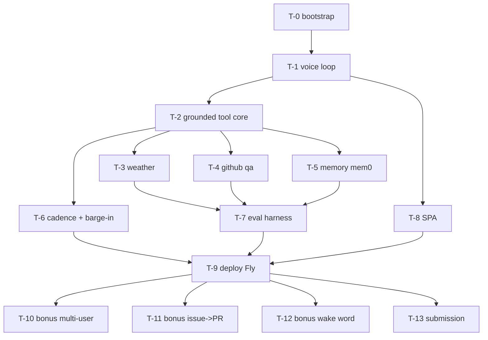

# Jarvis — Task Graph

`docs/tickets.json` is authoritative (hooks and Tasks ingestion read it).
This file is the human mirror.

## Dependency graph

## Sequencing (agentic-execution terms)

- Critical path: T-0 → T-1 → T-2 → {T-3/T-4/T-5} → T-7 → T-9 → T-13.
  ~1 focused Claude Code session per ticket; 14 tickets ≈ 14 session-units,
  compressible to ~9 sequential slots with parallelism below.
- **Parallel window after T-2 closes**: T-3, T-4, T-5, T-6, T-8 are
  parallel-safe (disjoint scopes). Max 3 concurrent worktrees.
  Suggested waves: wave 1 = T-4, T-5, T-8 (the heavy three);
  wave 2 = T-3, T-6.
- **Merge order (required)**: T-3 → T-4 → T-5 → T-6 → T-8. Rebase each
  worktree on the previous merge before merging.
- Bonuses execute strictly in priority order after T-9:
  T-10 → T-11 → T-12. T-13 (submission) claims last but does NOT wait for
  bonuses — submit with whatever is green.
- Mobile (R12) has no ticket by design. If T-10..T-12 all close early,
  ask Hank before drafting a mobile ticket.

## Tickets

See `docs/tickets.json` for the full contracts (objective, refs, acceptance,
verify, scope, depends_on, non_goals). Summary:

| ID | Outcome | Depends on | Parallel-safe |
|----|---------|------------|---------------|
| T-0 | Skeleton + harness + light CI green | — | no |
| T-1 | Voice loop end-to-end on LiveKit | T-0 | no |
| T-2 | Grounded tool-calling core + self-manifest | T-1 | no |
| T-3 | Weather grounded in live Open-Meteo | T-2 | yes |
| T-4 | GitHub Q&A with oversize degradation | T-2 | yes |
| T-5 | Cross-session memory via mem0/pgvector | T-2 | yes |
| T-6 | Fillers, barge-in, stop phrase | T-2 | yes |
| T-7 | Eval harness: 0 fabrications on approved set | T-3,4,5 | no |
| T-8 | Polished SPA with live transcript/state | T-1 | yes |
| T-9 | Deployed on Fly, smoke + latency report green | T-6,7,8 | no |
| T-10 | Bonus: Clerk multi-user + preferences | T-9 | no |
| T-11 | Bonus: issue→PR with audible progress | T-9 | no |
| T-12 | Bonus: wake word passive mode | T-9 | no |
| T-13 | Submission sent (video/docs/zip) | T-9 | no |
